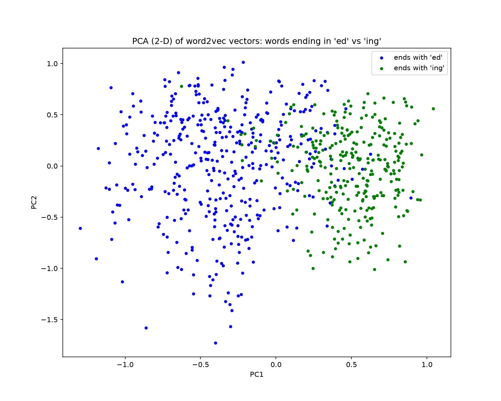

# A.4 Plotting words in 2D

We took `model.index_to_key[1:5000]` from `word2vec-google-news-300`, kept the words ending in `ed` or `ing` (708 words: 414 `ed`, 294 `ing`), fit PCA on their 300-d vectors and plotted the 2-d projection (`ed` blue, `ing` green). Code: `a4_plot.py`.

**Are the colors separated?** Mostly, yes. The separation is along PC1: `ed` words sit on the left, `ing` words on the right, and there is a mixed band around PC1 ≈ 0–0.3. PC2 does not separate them at all; both groups spread over it similarly.

**Why isn't it a clean split?**

- PCA picks the directions of largest variance, not the directions that best separate our two classes. The two components explain only 7.6% of the variance (4.2% + 3.4%), so most of the information in the vectors is not in the picture. Most of the variance in word2vec is about meaning and topic, not morphology.
- The suffix is a surface feature, and not every word with it is a verb form. The vectors are learned from contexts, so a word lands where its *usage* puts it:
  - `ing` words on the blue side: *according/According, During, Following, Speaking, pending, citing, referring, investigating*. Most of these behave like prepositions or discourse markers ("according to", "During the", "Following the"), not progressive verbs.
  - `ed` words on the green side: *need, speed, feed, Fed*. Here "ed" is just part of the word, not a past-tense suffix.
  - Nouns like *building, thing, something* still fall with the `ing` group, and *morning* falls in the middle band, so the axis is not purely "verb vs. not verb" either.

**Is the information in the model?** Yes. To check this (analysis only, not part of the required plot) we ran 5-fold cross-validated logistic regression to predict `ed` vs `ing`:

| Input | Accuracy |
|---|---|
| majority class baseline | 58.5% |
| 2-d PCA coordinates | 90.4% |
| full 300-d vectors | 96.6% |

So the distinction is encoded in the vectors, and is close to linearly separable in the full space. Even the first principal component already captures much of it, which suggests the past-tense/participle vs. progressive contrast is one of the stronger directions in this subset. The 2-d plot just shows a lossy view of it, and the remaining errors are mostly the words above where the suffix does not carry its usual grammatical meaning.
